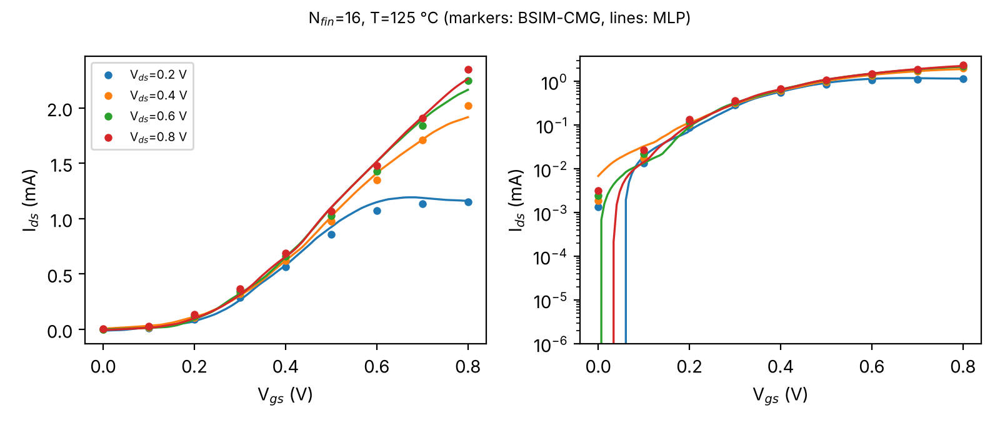

# FinFET drain-current surrogate (finfet-ids-surrogate)

**English** · [简体中文](README_CN.md)

A small PyTorch study that learns the drain current of a 15 nm-class n-type FinFET from BSIM-CMG simulation data, and checks where a plain neural-network surrogate is and is not reliable.

Inputs are fin number, channel length, process corner, temperature, V<sub>ds</sub> and V<sub>gs</sub>; the output is I<sub>ds</sub>.

## Background

This started as a two-person project (Shun Hao Pang and Jiayi Zhu) in the Shanghai Jiao Tong University summer program *Emerging Semiconductor Devices and Their Sustainable Innovations* (July 2025). The same group also reviewed deep-learning extraction of BSIM-CMG parameters (Kao et al., *IEEE Trans. Electron Devices* 69, 4765, 2022).

| Folder | Contents |
| --- | --- |
| [`original/`](original/) | The July 2025 training script and its three output figures, kept unchanged |
| [`src/finfet_ids_mlp.py`](src/finfet_ids_mlp.py) | Cleaned version (2026): same network and training settings, plus fixed seeds, several train/test splits and held-out metrics |
| [`results/`](results/) | Metrics for every split and seed, a summary, and held-out figures |
| [`data/`](data/README.md) | Data format; the simulation file itself is not redistributed |

## Model

- MLP: 6 → 100 → 50 → 20 → 1, ReLU, batch normalization and dropout (0.1) in the first two hidden layers
- Huber (smooth L1) loss on standardized I<sub>ds</sub>, Adam (lr 1e-3, weight decay 1e-5), cosine-annealing schedule, early stopping (patience 50)

## Results

Test metrics, mean of three seeds (0, 1, 2). MAPE is computed only for points with |I<sub>ds</sub>| > 1 µA.

| Split | What is held out | Test points | R² (mean, range) | RMSE (µA) | MAPE above 1 µA |
| --- | --- | --- | --- | --- | --- |
| `ordered` | last 10 % of the file, as in the 2025 script | 113 | 0.996 (0.996–0.998) | 32 | 54 % |
| `random-points` | random 10 % of bias points | 113 | 0.997 (0.996–0.998) | 23 | 78 % |
| `random-curves` | random 10 % of whole Id–Vg sweeps | 108 | 0.997 (0.995–0.999) | 22 | 75 % |
| `holdout-temp` | every sweep at 125 °C (temperature extrapolation) | 225 | 0.988 (0.982–0.991) | 46 | 87 % |

<p align="center">

</p>

**What this shows**

1. **Above threshold the surrogate is accurate.** On a linear scale the predicted curves follow BSIM-CMG closely, and R² stays above 0.99 for unseen sweeps.
2. **Below threshold it fails.** On a log scale the predictions are off by orders of magnitude and can turn negative. The loss is computed on linear current, so near-zero currents carry almost no weight; the high R² hides this, and the large relative error exposes it.
3. **Extrapolating in temperature costs accuracy.** Holding out all 125 °C data lowers R² and roughly doubles the error.

The first point is why the original 2025 figures looked convincing; the second is the main limitation. A log-current or arcsinh target, or a physics-based output layer, would be the natural next step for subthreshold behavior.

**Caveat.** As in the original script, early stopping monitors the held-out set, so the test metrics are slightly optimistic.

## Reproduce

```bash
python3 -m venv .venv && . .venv/bin/activate
pip install -r requirements.txt
# put N15A-nmos1.json in data/ (see data/README.md)
for s in ordered random-points random-curves holdout-temp; do
  for seed in 0 1 2; do python src/finfet_ids_mlp.py --data data/N15A-nmos1.json --split $s --seed $seed; done
done
```

Runs on CPU in a few seconds each.
