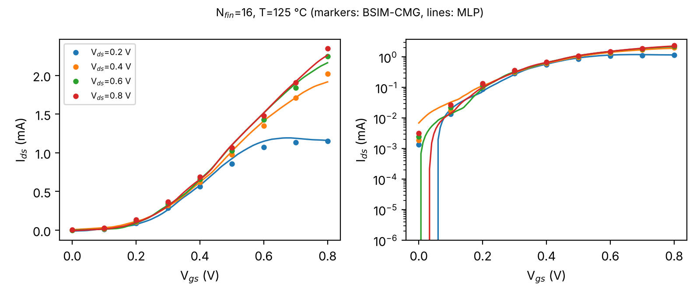

# FinFET 漏极电流代理模型（finfet-ids-surrogate）

[English](README.md) · **简体中文**

一项 PyTorch 研究：评估神经网络代理模型对 15 nm 级 n 型 FinFET 的 BSIM-CMG 漏极电流仿真的拟合表现。我在 2025 年双人项目的基础上，增加了固定随机种子，以及偏置点、整条曲线和温度留出评估。

**主要发现。** 模型在线性坐标下能追踪导通区电流趋势，但较高的 R² 掩盖了相对误差与亚阈值预测问题。不同工作区域的表现对照是这项研究的核心结果。

输入为鳍数、沟道长度、工艺角、温度、V<sub>ds</sub> 与 V<sub>gs</sub>，输出为 I<sub>ds</sub>。

## 背景

本项目源自 2025 年 7 月上海交通大学暑期项目 *Emerging Semiconductor Devices and Their Sustainable Innovations* 中的双人课题（Shun Hao Pang 与 Jiayi Zhu）。同组还研读了基于深度学习的 BSIM-CMG 参数提取工作（Kao et al., *IEEE Trans. Electron Devices* 69, 4765, 2022）。

| 文件夹 | 内容 |
| --- | --- |
| [`original/`](original/) | 2025 年 7 月的训练脚本及其三张输出图，保持原样 |
| [`src/finfet_ids_mlp.py`](src/finfet_ids_mlp.py) | 整理后的版本（2026）：网络结构与训练设置不变，增加固定随机种子、多种训练/测试划分及留出集指标 |
| [`results/`](results/) | 各划分与各种子的指标、汇总及留出集图像 |
| [`data/`](data/README.md) | 数据格式说明；仿真数据文件本身不再分发 |

## 模型

- MLP：6 → 100 → 50 → 20 → 1，ReLU 激活，前两个隐藏层使用批归一化与 dropout（0.1）
- 对标准化后的 I<sub>ds</sub> 使用 Huber（smooth L1）损失，Adam 优化器（lr 1e-3，权重衰减 1e-5），余弦退火学习率，早停（patience 50）

## 结果

留出集指标取三个种子（0、1、2）的平均值。早停使用同一留出集，因此这些是模型选择阶段的指标，而非独立最终测试集估计。MAPE 仅对 |I<sub>ds</sub>| > 1 µA 的点计算。

| 划分 | 留出内容 | 评估点数 | R²（均值，范围） | RMSE (µA) | 1 µA 以上 MAPE |
| --- | --- | --- | --- | --- | --- |
| `ordered` | 文件末尾 10 %，与 2025 年脚本一致 | 113 | 0.996 (0.996–0.998) | 32 | 54 % |
| `random-points` | 随机 10 % 偏置点 | 113 | 0.997 (0.996–0.998) | 23 | 78 % |
| `random-curves` | 随机 10 % 完整 Id–Vg 扫描曲线 | 108 | 0.997 (0.995–0.999) | 22 | 75 % |
| `holdout-temp` | 125 °C 下的全部扫描（温度外推） | 225 | 0.988 (0.982–0.991) | 46 | 87 % |

<p align="center">

</p>

**结论**

1. **线性坐标下的导通区趋势得到捕捉。** 整条扫描曲线留出时 R² 仍高于 0.99，但 1 µA 以上的 MAPE 为 75%；两个指标衡量的是不同的拟合特征。
2. **亚阈值电流仍需改进。** 对数坐标下预测值可相差数个数量级，甚至出现负值；线性电流损失对接近零的数值权重较低。
3. **温度外推更难。** 留出全部 125 °C 扫描后，R² 为 0.988，RMSE 升至 46 µA。

针对亚阈值区，下一步可测试对数电流或 arcsinh 目标，或引入基于物理的输出层。

## 复现

```bash
python3 -m venv .venv && . .venv/bin/activate
pip install -r requirements.txt
# 将 N15A-nmos1.json 放入 data/（见 data/README.md）
for s in ordered random-points random-curves holdout-temp; do
  for seed in 0 1 2; do python src/finfet_ids_mlp.py --data data/N15A-nmos1.json --split $s --seed $seed; done
done
```

在 CPU 上每次运行仅需数秒。
